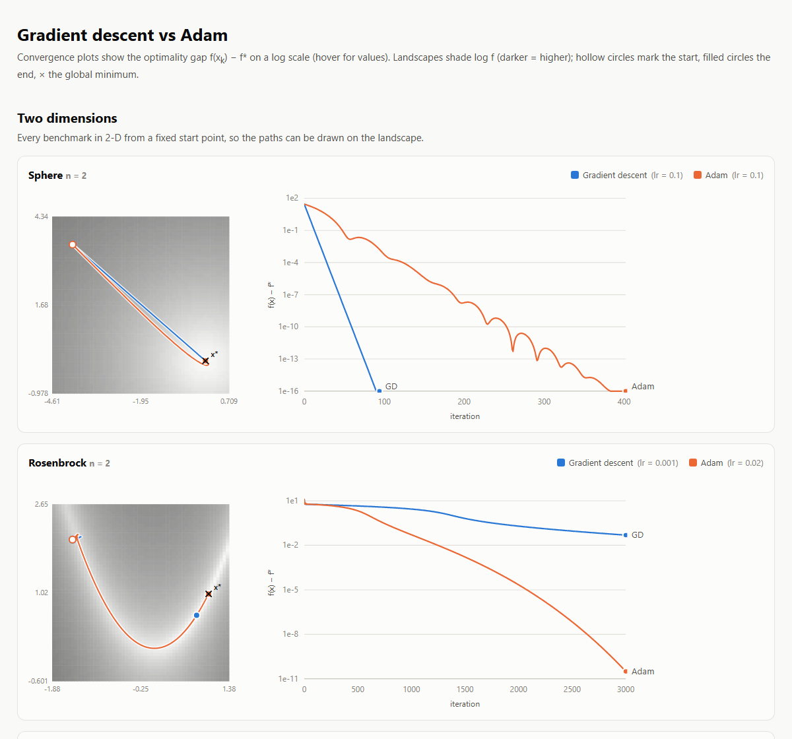

# Basic implementation of optimisation functions

Implementation of Gradient Descent and Adam, tested on several test functions organised in an object-oriented manner.



## Motivations

Originally developed for an Undergraduate project (L3 ISFA), and upgraded to explore more about the low-level language C++ using Claude Code.

## Quick start

Once a C++20 compiler is installed (see [Installation](#installation)), one command builds, runs, and opens the report:

```powershell
# Windows (MSYS2 CLANG64)
powershell -ExecutionPolicy Bypass -File build.ps1 -Open
```
```
# Any platform with CMake
cmake -S . -B build
cmake --build build --target run
```

The results are deterministic. To check that your run reproduces the reference output in this README exactly, use `build.ps1 -Check` (see [Check reproducibility](#check-reproducibility)).

## Installation

The project is plain C++20 with **no external library**. You only need a C++20 compiler.

### Windows (MSYS2 CLANG64, recommended)

1. Install [MSYS2](https://www.msys2.org/). The default location is `C:\msys64`.
2. Open the **"MSYS2 CLANG64"** terminal from the Start Menu (the prompt shows `CLANG64`) and install the toolchain:
   ```
   pacman -Syu
   pacman -S --needed mingw-w64-clang-x86_64-clang mingw-w64-clang-x86_64-lldb mingw-w64-clang-x86_64-clang-tools-extra
   ```
   `pacman -Syu` may ask you to close the terminal. If it does, reopen it and run the second command.
3. Add `C:\msys64\clang64\bin` to your **user** `Path`. In *Start → "Edit environment variables for your account"*, select `Path`, click *Edit*, then *New*. Open a new terminal afterwards.
4. Check it:
   ```powershell
   clang++ --version
   ```

Use the **CLANG64** environment only. Packages from UCRT64/MINGW64 (`mingw-w64-ucrt-x86_64-*`, `mingw-w64-x86_64-*`), MSVC, and GCC use a different standard library and will not link with it.

### Linux / macOS, or Windows with CMake

Any of **Clang ≥ 17, GCC ≥ 13, or MSVC 2022** works, plus **CMake ≥ 3.20**. The code uses `<format>`, so older compilers will not build it. With MSYS2 you can add CMake and Ninja through pacman:
```
pacman -S --needed mingw-w64-clang-x86_64-cmake mingw-w64-clang-x86_64-ninja
```

### Get the code

```
git clone https://github.com/alexandrejulien311/optimisation_benchmark
cd optimisation_benchmark
```

## Build and run

### Windows: `build.ps1`

From PowerShell (the script works from any folder, because it uses paths relative to the project root):
```powershell
powershell -ExecutionPolicy Bypass -File build.ps1 -Run
```
This compiles `main.cpp` and every `.cpp` under `src/` into `build/benchmark.exe`, then runs it from the project root. `-ExecutionPolicy Bypass` applies only to this command and lets Windows run the local script without changing any system setting. Flags can be combined:

| Flag | Effect |
|---|---|
| *(none)* | Build only (`-O2`) |
| `-Run` | Build, then run the benchmark |
| `-Open` | Build, run, and open `benchmark_report.html` in the browser |
| `-Check` | Build, run, and compare the output with the reference below. Exits with code 1 on any difference |
| `-Debug` | No optimisation (`-O0`), for stepping through with LLDB |
| `-Static` | Standalone `.exe` that runs on a machine without MSYS2 |

The script prints the compiler version first, so a log of the run records which toolchain produced it.

### Any platform: CMake

```
cmake -S . -B build
cmake --build build --target run
```
The `run` target builds the program if needed and runs it from the project root, whatever the generator. Add `-G Ninja` to the first command if Ninja is installed. To build without running, use `cmake --build build --config Release`. The executable is then `build/benchmark` (`.exe` on Windows), or `build/Release/benchmark.exe` with Visual Studio.

### Expected output

The program runs gradient descent and Adam on every benchmark function. It runs them in 2-D from fixed start points, then the n-dimensional functions in 10-D from a random start drawn with seed 42. Everything is deterministic, so you should see exactly this:

```
Function       n  Optimiser               lr  iters  status                f - f*
--------------------------------------------------------------------------------
Sphere         2  Gradient descent       0.1     94  converged          1.706e-17
Sphere         2  Adam                   0.1    402  converged          2.264e-17
Rosenbrock     2  Gradient descent     0.001   3000  max iterations     4.867e-02
Rosenbrock     2  Adam                  0.02   3000  max iterations     3.148e-11
Rastrigin      2  Gradient descent     0.002     17  converged          1.293e+01
Rastrigin      2  Adam                  0.05    425  converged          1.293e+01
Ackley         2  Gradient descent      0.05   3000  max iterations     9.480e+00
Ackley         2  Adam                   0.1    392  converged          7.962e+00
Booth          2  Gradient descent      0.05    204  converged          2.100e-17
Booth          2  Adam                   0.2    430  converged          1.544e-17
Beale          2  Gradient descent     0.001   3000  max iterations     9.988e-03
Beale          2  Adam                  0.05   2995  converged          1.648e-16
Himmelblau     2  Gradient descent      0.01     33  converged          1.622e-19
Himmelblau     2  Adam                   0.1    425  converged          3.604e-19
Sphere        10  Gradient descent       0.1     93  converged          1.680e-17
Sphere        10  Adam                   0.1    385  converged          2.407e-17
Rosenbrock    10  Gradient descent     0.001   3000  max iterations     5.438e-02
Rosenbrock    10  Adam                  0.02   3000  max iterations     9.022e-12
Rastrigin     10  Gradient descent     0.002     22  converged          4.378e+01
Rastrigin     10  Adam                  0.05    458  converged          4.378e+01
Ackley        10  Gradient descent      0.05     33  converged          1.640e+01
Ackley        10  Adam                   0.1    376  converged          1.640e+01

Report written to benchmark_report.html
```

This output was produced with clang 23.1 / libc++ (MSYS2 CLANG64). With another compiler or standard library, the last digits of very small values (around 1e-16) may differ, because `std::exp`, `std::cos`, etc. are not guaranteed to round identically everywhere. The iteration counts, statuses and conclusions stay the same.

### Check reproducibility

All inputs are fixed: hard-coded start points and hyper-parameters, a `std::mt19937` seeded with 42 (its sequence is specified by the C++ standard), and a hand-written uniform draw instead of `std::uniform_real_distribution`, whose output varies between standard libraries. So the same toolchain always gives the same output.

- **Reference toolchain (MSYS2 CLANG64):** `build.ps1 -Check` compares the whole output with the block above, character for character.
- **Other compilers (CMake):** `bash .github/scripts/check_output.sh <path-to-benchmark>` compares every column except `f - f*`.

The CI (`.github/workflows/ci.yml`) runs both checks on every push: `build.ps1 -Check` on Windows/MSYS2, and the CMake build with GCC (Linux), Apple Clang (macOS) and MSVC (Windows).

### Open the report

`build.ps1 -Open` opens it for you. Otherwise:

```powershell
start benchmark_report.html     # Windows
xdg-open benchmark_report.html  # Linux
open benchmark_report.html      # macOS
```

The report is a single self-contained HTML file with no internet access needed. For each function it shows:
- the **convergence plot**: f(x<sub>k</sub>) − f* on a log scale vs iteration (hover for values);
- for 2-D functions, the **landscape** with both optimisation paths (hollow circle = start, filled circle = end, × = global minimum);
- a **summary table** of all runs.

### Troubleshooting

| Symptom | Fix |
|---|---|
| `clang++` is not recognised | `C:\msys64\clang64\bin` is not on your user `Path`, or the terminal was opened before you added it |
| `no member named 'format' in namespace 'std'` | The compiler is not in C++20 mode; build with `build.ps1` / CMake, or pass `-std=c++20` |
| The `.exe` complains about missing `libc++.dll` | Run it from a terminal where `C:\msys64\clang64\bin` is on `Path`, or rebuild with `build.ps1 -Static` |
| "running scripts is disabled on this system" | Use `powershell -ExecutionPolicy Bypass -File build.ps1` as shown above |
| `build.ps1 -Check` reports differences | Check that the first line printed is a clang/MSYS2 CLANG64 compiler. With another toolchain, only the last digits of tiny `f - f*` values may differ |

## Project structure

```
main.cpp                          benchmark driver: runs GD and Adam, writes the report
build.ps1                         Windows build/run/check script (clang++, no CMake needed)
CMakeLists.txt                    cross-platform build, with a `run` target
.github/workflows/ci.yml          builds and checks the output on 4 toolchains
.github/scripts/check_output.sh   compares a run with the expected output in this README
src/optimisation_project/
  benchmark_functions/            BenchmarkFunction base class + Sphere, Rosenbrock,
                                  Rastrigin, Ackley, Booth, Beale, Himmelblau
  optimisation_algorithm/         Optimiser base class, GradientDescent, Adam,
                                  minimise() driver loop
  report/                         HTML/SVG report generator
docs/report_preview.png           screenshot used in this README
```
